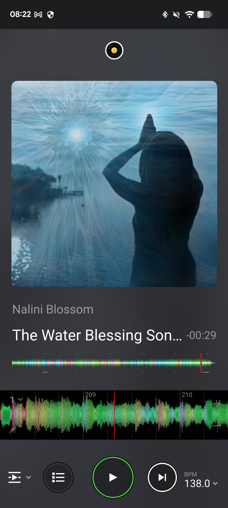
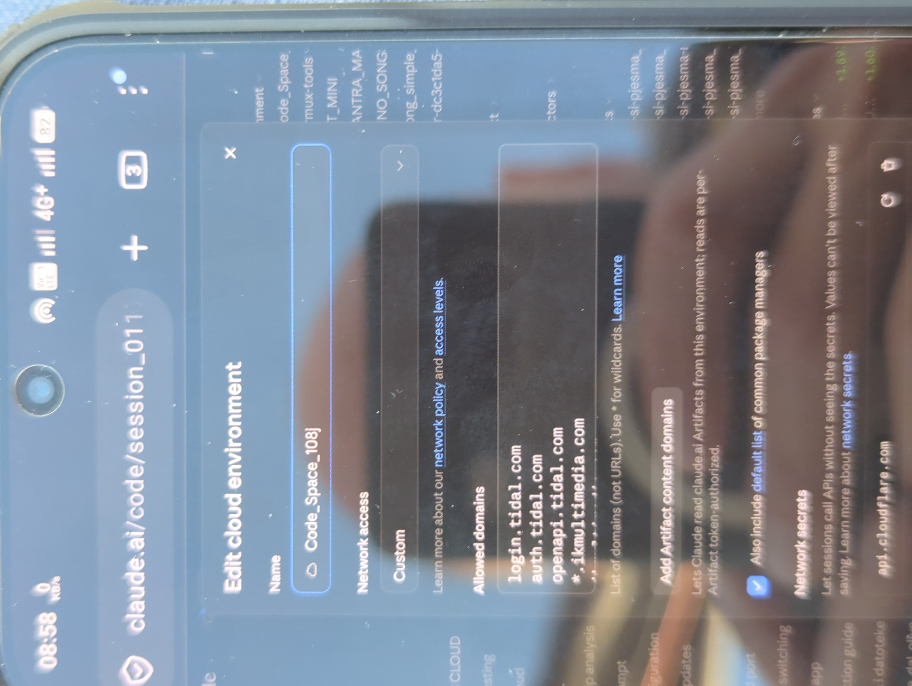

# HANDOVER: finish 2 playlists on TIDAL: "Reggae Vocal Healing (generated)" and "Tech House Groove (generated)"

Written 2026-10-16 by the Claude Code session that started this repo. That session could not reach TIDAL,
so the next session (in the **Code_Space_108j** environment) finishes the job. Read this whole file, then do
**The task** at the bottom.

## What Marko asked (his words, cleaned up)

> In this chat we generate playlists from reference songs, to continue in the same musical style. This is the
> first one: reggae vocal healing songs (like "Apache" and similar artists). Generate the playlist on my TIDAL
> account, and in this repository write text files with artist and song name. If you need secrets for TIDAL
> that are not in the environment, tell me. My DJ app is TIDAL-compatible and the code is already there. When
> you create the playlist, put **(generated)** in the name, so I know Claude made it.

- **Reference song** (screenshot from his DJ app, below): **Nalini Blossom - The Water Blessing Song**
  (shown at 138.0 BPM in the app, so a half-time feel of about 69 BPM).
- About "Apache": he is not sure of the band's name. He thinks they sing about **women healers**. He said
  "whatever, it's similar", so no change was made. If you recognise the band, add 1-3 of their songs and
  mention it.

## What is done (branch `ccr-bd69dadb-47iidg`)

| File | What |
|---|---|
| `playlists/2026-10-16_reggae-vocal-healing.txt` | 36 songs, `Artist - Title` per line, first `#` line = playlist name |
| `tools/tidal_playlist.py` | stdlib-only Python: TIDAL login (PKCE, paste-back), search, create playlist |
| `README.md` | repo conventions + index table of playlists |
| `handover/` | the two screenshots in this file |

**The flow of the list:** it opens with the reference song, then healing and medicine-style vocals (Jah9, Mike
Love, Trevor Hall, Nahko, Xavier Rudd, Rising Appalachia, Nattali Rize), then female roots vocals (Etana,
Hempress Sativa, Lila Iké), then roots reggae (Chronixx, Protoje, Kabaka Pyramid, Samory I, the Marleys,
Matisyahu, Alborosie, ...). It closes on Bob Marley "Natural Mystic".

**How the TIDAL part works:** it copies Marko's macOS app `markoboskoauroville/SCREENSHOT_TO_TIDAL`
(`app/Tidal.swift`):
- the "DJ Mantra" TIDAL app, client id `JjTAmDVohiV7GgOL`, public client (no secret needed);
- OAuth 2.1 authorization code + PKCE, redirect `http://localhost:8765/tidal-callback`;
- scopes `user.read search.read playlists.read playlists.write`;
- API `https://openapi.tidal.com/v2` (JSON:API). Playlists are made `UNLISTED`, tracks are added 20 at a time.

The Mac app catches the redirect with a local listener. In the cloud there is none, so the script prints the
login URL and Marko pastes back the `localhost:8765/...` URL his browser lands on (the page fails to load;
that is expected).

**Not yet proven:** the script has never talked to TIDAL. In particular the search call tries
`GET /searchResults/{query}` first and falls back to `GET /searchResults?filter[query]=` (the form the Swift
app uses). If either call fails, fix it from the error text TIDAL returns.

## Why it stopped

- The first session ran in the **Default** environment of the account `marko.bosko@gmail.com` ("trusted"
  network). `login.tidal.com`, `auth.tidal.com` and `openapi.tidal.com` were all refused there: the proxy
  answered 403 to CONNECT.
- Marko added those domains in another environment, **Code_Space_108j**: Custom access, package managers ticked
  (screenshot below). That environment belongs to a different account or organization than the first session,
  which could not see it or switch to it. He also sees different chats on his two phones, which fits that.
- So: **continue from a session in Code_Space_108j.**

## The task (for the next session)

1. Clone `markoboskoauroville/generated_playlists` and check out branch `ccr-bd69dadb-47iidg`. Develop and push
   on that branch (or the branch your session is given, after merging this one into it).
2. Check TIDAL is reachable (any HTTP code, not a refused connection):
   `for h in login.tidal.com auth.tidal.com openapi.tidal.com; do curl -s -o /dev/null -w "$h %{http_code}\n" https://$h/; done`
   If it is refused, tell Marko which host was refused and stop.
3. `python3 tools/tidal_playlist.py login-url`. Send Marko the URL and ask him to log in and paste back the
   `http://localhost:8765/tidal-callback?code=...&state=...` address his browser lands on. Run all steps in
   the **same container**: the PKCE verifier is kept in `~/.config/tidal_generated/pkce.json`.
4. `python3 tools/tidal_playlist.py login-finish '<pasted URL>'`. The scope it prints must include
   `playlists.write`. If it doesn't, the DJ Mantra app on developer.tidal.com needs that scope (see the
   SCREENSHOT_TO_TIDAL README).
5. `python3 tools/tidal_playlist.py create playlists/2026-10-16_reggae-vocal-healing.txt --dry-run`, and check
   the matches. For a song below 60 % or wrongly matched, fix the line in the txt file (exact TIDAL spelling) or
   swap it for a similar song in the same style that does exist.
6. Then without `--dry-run`. The playlist must be named **Reggae Vocal Healing (generated)**. Give Marko the
   `https://tidal.com/playlist/<id>` link and the list of songs that were not found or were swapped.
7. Commit the corrected txt (and any script fixes). In the README table, add the TIDAL link. Push.
8. Optional, if Marko agrees: so future sessions don't need the login dance, he can save the refresh token as a
   `TIDAL_REFRESH_TOKEN` environment variable of Code_Space_108j. It is in `~/.config/tidal_generated/token.json`
   after login. Never commit the token or print it in the chat unless he asks for it.

## Second playlist: Tech House Groove (generated)

Marko then sent `TIDAL.txt`: 100 tracks (`Artist | Title | tidal search link`), all house / tech house
(Prospa, Franky Rizardo, ANOTR, Mochakk, Cloonee, Chris Lake, ...). He asked: "please build this playlist on
tidal". He gave no name, so it is **Tech House Groove (generated)** (rename it if he says otherwise). It is
converted, in his order, to `playlists/2026-10-16_tech-house-groove.txt`.
- Some songs appear twice ("Edge of Desire" rows 1 and 89, "Look Good" rows 40 and 67). The script adds each
  TIDAL track only once.
- After the reggae playlist is done (same login, same container), run steps 5-7 above for this file too,
  without needing a second login. Give him both links.

**Next playlists:** Marko will send more reference songs (screenshots from his DJ app). Each one gets a new
`playlists/YYYY-MM-DD_<style>.txt`, a TIDAL playlist ending in "(generated)", and a README table row.
